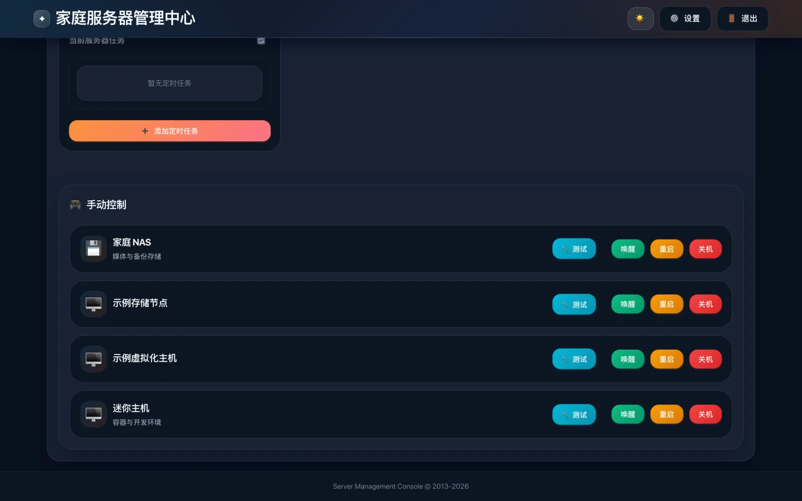
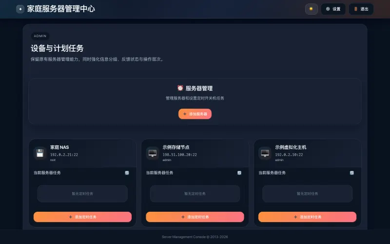
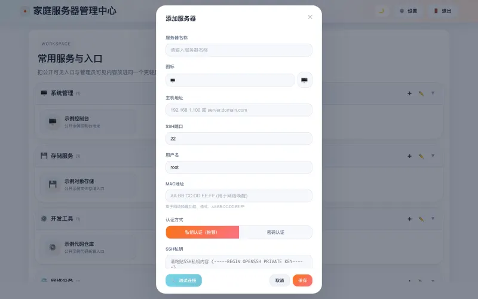
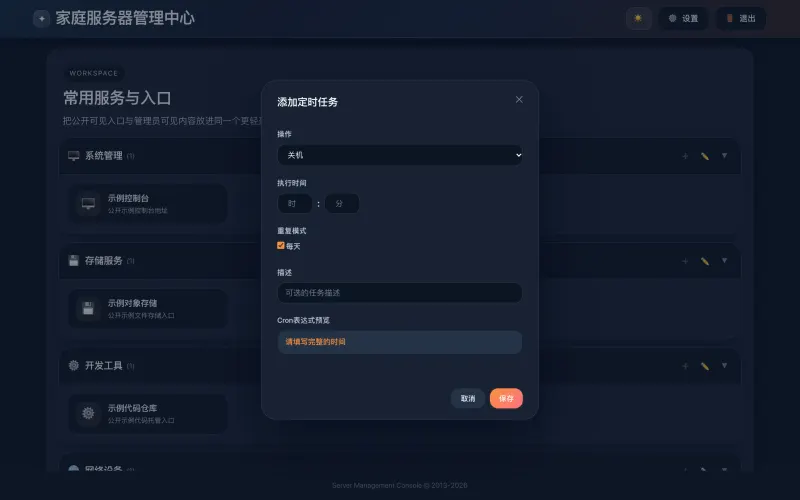
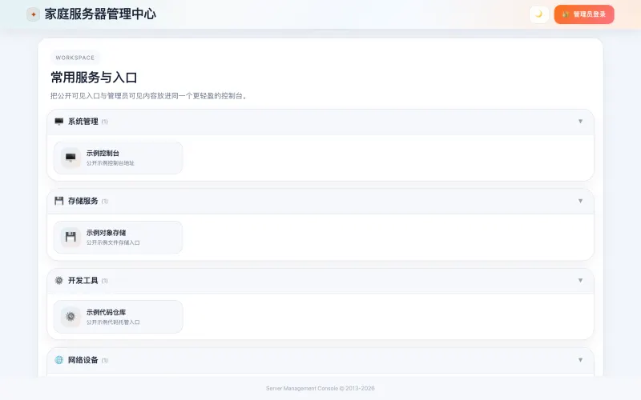

<p align="center"></p>

<h1 align="center">家庭服务器管理中心 · Home Server Manager</h1>

<p align="center">
  自托管的家庭服务器控制台：网络唤醒、SSH 关机与重启、定时任务、服务入口导航<br>
  <a href="https://servermanager.vanjay.cn/">主页</a> ·
  <a href="https://github.com/wangwanjie/my_web_page/releases/latest">Release</a> ·
  <a href="#english">English</a>
</p>



## 功能

- **网络唤醒远程开机**：为服务器填好 MAC 地址，点「唤醒」就向 `255.255.255.255:9` 发送网络唤醒魔术包。
- **SSH 关机与重启**：通过 SSH 执行 `/sbin/shutdown -h now` 或 `/sbin/reboot`，支持私钥与密码认证，保存前可测试连接并查看耗时。
- **定时关机与重启**：选择时间与每天或指定星期，任务写进目标服务器自己的 crontab，管理中心离线时照常执行；已有任务可查看、编辑、停用、删除。
- **服务入口导航**：按分组整理常用服务，每个入口可填内网、FRP、IPv6、Cloudflare 四种地址；内网地址只对管理员显示，分组可设为未登录可见。
- **登录保护**：管理员账号支持 TOTP 双因素认证，可选接入 Google、GitHub、QQ 第三方登录。
- **浅色 / 深色主题**，手机上同样可用。

| 服务器与定时任务 | 添加服务器 |
| --- | --- |
|  |  |
| **添加定时任务** | **服务入口** |
|  |  |

截图来自本机启动的演示实例，服务器与入口均为示例数据。

## 部署

需要一台装有 Docker 与 Docker Compose 插件的 Linux 主机（linux/amd64 或 linux/arm64），并与要管理的服务器在同一局域网。镜像公开发布在 Docker Hub：

- `docker.io/vanjayak/server-management-backend:latest`
- `docker.io/vanjayak/server-management-frontend:latest`

```bash
mkdir home-server-manager && cd home-server-manager
curl -LO https://github.com/wangwanjie/my_web_page/releases/latest/download/docker-compose.yml
curl -L -o .env https://github.com/wangwanjie/my_web_page/releases/latest/download/env.example

# 生成三个签名密钥，然后把 .env 里的 APP_BASE_URL 改成你访问面板的地址
for k in JWT_SECRET JWT_REFRESH_SECRET OAUTH_STATE_SECRET; do
  sed -i "s|^$k=.*|$k=$(openssl rand -hex 32)|" .env
done

docker compose up -d
```

启动后访问 `http://主机IP:3800`。

> [!WARNING]
> 首次启动的管理员账号是 `admin`，密码 `ChangeMe123!`，所有安装都相同。登录后请立即在「设置 → 管理员设置」修改用户名和密码，并在「双因素认证」中开启 TOTP。

完整的 `docker-compose.yml`：

```yaml
services:
  backend:
    image: ${BACKEND_IMAGE:-docker.io/vanjayak/server-management-backend:latest}
    container_name: home-server-manager-backend
    restart: unless-stopped
    env_file:
      - .env
    environment:
      - NODE_ENV=production
      - PORT=3001
      - DB_PATH=/app/data/database.db
    # network_mode: host
    volumes:
      - backend_data:/app/data

  frontend:
    image: ${FRONTEND_IMAGE:-docker.io/vanjayak/server-management-frontend:latest}
    container_name: home-server-manager-frontend
    restart: unless-stopped
    depends_on:
      - backend
    ports:
      - "${FRONTEND_PORT:-3800}:80"
    # extra_hosts:
    #   - "backend:host-gateway"

volumes:
  backend_data:
```

**远程开机**：魔术包从后端容器发往广播地址，Docker 默认桥接网络通常不会把它转发到局域网。需要远程开机时，取消 `network_mode: host` 与 `extra_hosts` 两处注释后重新 `docker compose up -d`，后端会使用宿主机网络并占用 3001 端口。目标机器还需在 BIOS 与网卡中开启 Wake-on-LAN。

**升级**：`docker compose pull && docker compose up -d`，数据卷会保留。

**被管理的服务器**：需开启 SSH；关机与重启要求登录用户有执行 shutdown / reboot 的权限；定时任务依赖目标服务器上可用的 `crontab` 命令。

## 数据与安全

- 服务器列表、SSH 凭据、服务入口与设置都保存在 `backend_data` 数据卷的 SQLite 文件中，没有统计或遥测；只有启用第三方登录时才会与对应平台通信。
- SSH 密码与私钥以原文保存在数据库中，请限制宿主机与数据卷的访问权限，优先使用权限受限的私钥。
- 面板可以直接关停服务器。建议只在局域网或 VPN 内访问；需要公网访问时放在 HTTPS 反向代理之后并开启双因素认证。

## 反馈

问题与建议请提交到 [Issues](https://github.com/wangwanjie/my_web_page/issues)。

---

<a id="english"></a>

## English

Home Server Manager is a self-hosted web console for a home lab. The interface is in Simplified Chinese.

- **Wake-on-LAN**: save a server's MAC address and press Wake to broadcast a magic packet to `255.255.255.255:9`.
- **Shutdown and reboot over SSH** (`/sbin/shutdown -h now`, `/sbin/reboot`), with private key or password auth and a connection test that shows latency.
- **Scheduled shutdown and reboot**, written into each target server's own crontab so they run even when the manager is offline; jobs can be viewed, edited, disabled and removed.
- **Service shortcuts** in groups, each with LAN, FRP, IPv6 and Cloudflare addresses; LAN addresses are admin-only and groups can be public.
- **TOTP two-factor authentication** and optional Google, GitHub and QQ sign-in.

### Deploy

Requires a Linux host (linux/amd64 or linux/arm64) with Docker and the Compose plugin, on the same LAN as the servers you manage. Images are public on Docker Hub (`vanjayak/server-management-backend`, `vanjayak/server-management-frontend`).

```bash
mkdir home-server-manager && cd home-server-manager
curl -LO https://github.com/wangwanjie/my_web_page/releases/latest/download/docker-compose.yml
curl -L -o .env https://github.com/wangwanjie/my_web_page/releases/latest/download/env.example
for k in JWT_SECRET JWT_REFRESH_SECRET OAUTH_STATE_SECRET; do
  sed -i "s|^$k=.*|$k=$(openssl rand -hex 32)|" .env
done
# set APP_BASE_URL in .env to the address you use to open the panel
docker compose up -d
```

Open `http://HOST-IP:3800`.

> [!WARNING]
> The first-run admin account is `admin` / `ChangeMe123!` on every install. Sign in and change it right away under 设置 (Settings) → 管理员设置 (Admin settings), then enable TOTP under 双因素认证 (Two-factor authentication).

For Wake-on-LAN, uncomment `network_mode: host` and the `extra_hosts` lines in `docker-compose.yml`: Docker's default bridge network usually does not forward the broadcast to your LAN. The backend then uses the host network and port 3001.

Upgrade with `docker compose pull && docker compose up -d`.

### Data and security

All data (server list, SSH credentials, shortcuts, settings) lives in a SQLite file in the `backend_data` volume, with no analytics or telemetry. SSH passwords and private keys are stored as plain text, so restrict access to the host and the volume. Keep the panel on your LAN or VPN, or put it behind an HTTPS reverse proxy with two-factor authentication.

Feedback: [Issues](https://github.com/wangwanjie/my_web_page/issues) · More apps: [vanjay.cn](https://vanjay.cn) · © VanJay
